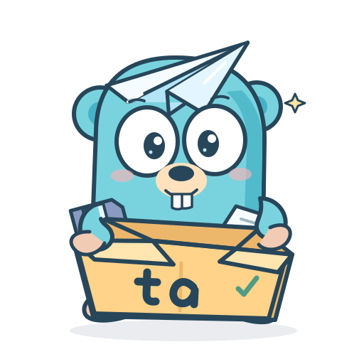
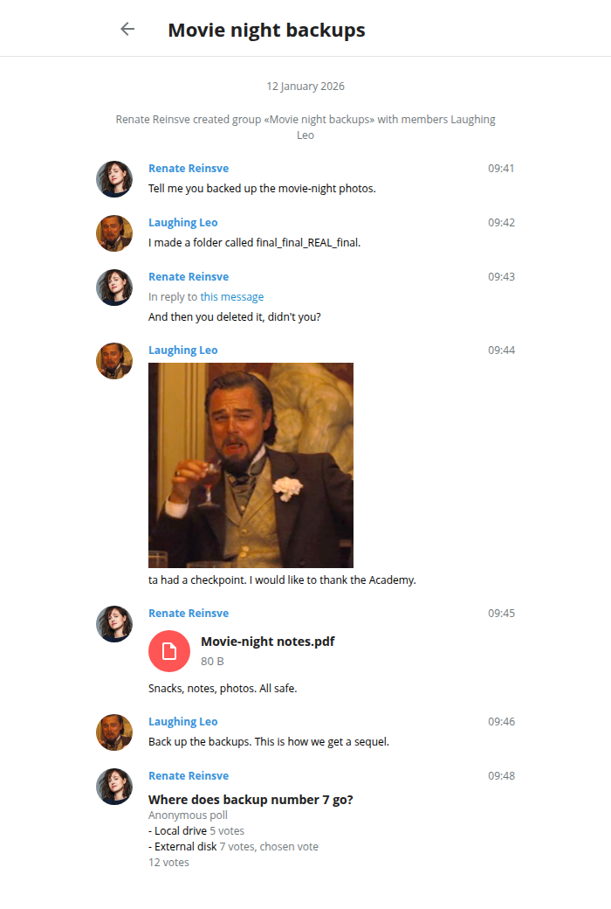
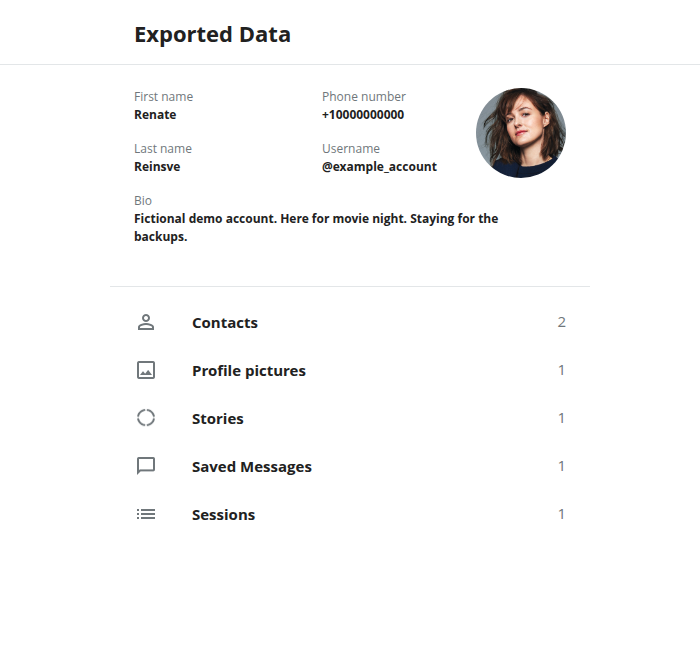

# ta (Telegram Archive)



ta backs up Telegram chats, groups and channels as JSON or offline HTML.
It downloads media, keeps checkpoints and adds new messages on later runs.
Back up and download files from restricted channels your account can access.
Inspired by [tdl](https://github.com/iyear/tdl), ta uses its transfer and session components.

## Supported features

- Archive chats, groups and public/private channels.
- Restricted/protected-content channel backups and downloads.
- Desktop-style JSON and offline HTML with local media.
- File-type, date and size filters.
- Parallel downloads with progress, resume and recovery.
- Archive and cron job results with message totals and media counts by type.
- Account data and Saved Messages backups.
- Incremental sync, refresh and cron schedules.
- Multiple saved Telegram accounts with separate cron backups.
- Offline rendering, statistics, uploads and forwarding.

## Installation

With Go 1.25.8 or newer installed, run:

```sh
go install github.com/mo1ein/TelegramArchive/cmd/ta@latest
ta --help
```

Run the same `go install` command to update ta. Go installs the binary into
`GOBIN`, or `GOPATH/bin` when `GOBIN` is unset. If your shell cannot find
`ta`, add that directory to your PATH. For the default macOS/Linux setup:

```sh
export PATH="$(go env GOPATH)/bin:$PATH"
```

Add the export line to `~/.zshrc` or `~/.bashrc` to keep it in new terminals.
On Windows, add the Go binary directory to your user `Path`.

To install a local checkout, including unpublished changes, run
`go install ./cmd/ta` or `make install` from the repository root.
`make build` remains available for a local `bin/ta` binary.

## Quick start

```sh
ta login -T qr                  # use -T code for phone/code login
ta archive --all --types channels --media all --format both
```

This exports every joined channel, including private channels and archived dialogs.
Files go to `./data`. Open `data/export_results.html` to browse them.
Resume is on by default. Rerun the same command to continue or fetch new messages.

## Common commands

```sh
# A private group by name; usernames, URLs and IDs also work.
ta archive --chat "Book Club" --media all

# PDF/ZIP files from joined channels, with date and size limits.
ta archive --all --types channels --media documents --extensions pdf,zip \
  --since 2026-01-01 --until 2026-02-01 --min-file-size 1024 \
  --max-file-size 104857600 --format html

# Account data, including Saved Messages, in a separate account directory.
ta account --include all --media all --format both

# Sync all chats and account data once.
ta sync --everything --format both

# Back up now, then let system cron sync this channel every six hours.
ta cron add my-channel --chat "channel_username" --every 6h \
  --media all --format both --output ./data --run-now
```

Use `--output` to choose a destination. Keep the same destination and filters when resuming.
Use a separate output root for each Telegram account.
Cron requires a working cron service and the `crontab` command.

See [Cron jobs for different accounts](docs/backups.md#cron-jobs-for-different-accounts)
for separate saved logins and schedules.

## HTML preview

Fictional meme demo in Telegram Desktop's export style. Profile photos added for illustration.
Click a preview to enlarge it.

<table>
  <tr><th>Chat export</th><th>Account export</th></tr>
  <tr>
    <td width="50%" valign="top"><a href="docs/assets/html-chat.png"></a></td>
    <td width="50%" valign="top"><a href="docs/assets/html-account.png"></a></td>
  </tr>
</table>

## Documentation

| Guide | Covers |
| --- | --- |
| [Archiving](docs/archiving.md) | Chat selection, media/date/size filters, custom names, resume, refresh, progress, JSON/HTML, offline rendering and statistics |
| [Backups](docs/backups.md) | Account sections, Saved Messages, one-time sync, recurring sync, cron jobs and logs |
| [Accounts and settings](docs/configuration.md) | Login, multiple terminals, proxies, storage, environment settings, transfer commands and build checks |
| [Transfers and tools](docs/README.md#transfers-and-tools) | Downloads, uploads, forwarding, chat tools, templates, session tools, extensions and shell completion |
| [Desktop export coverage](docs/desktop-compatibility.md) | Supported formats, fields and API limits |
| [Contributing](CONTRIBUTING.md) | Development workflow and privacy checks |

Run `ta --help` or `ta <command> --help` for command options.
